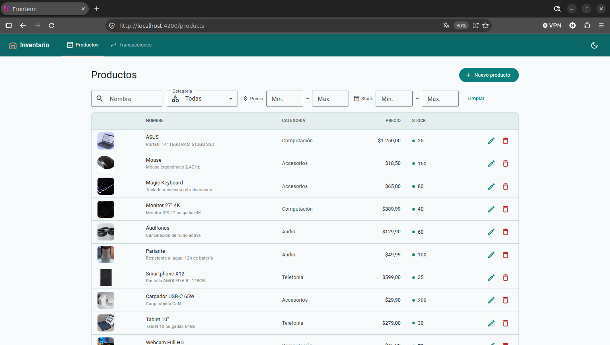
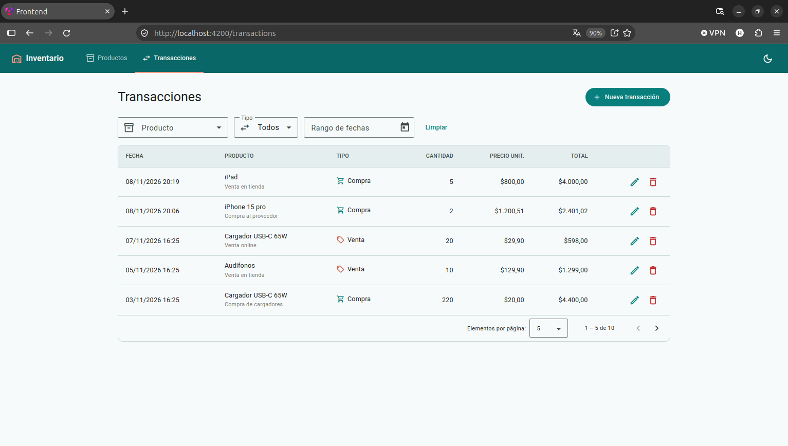
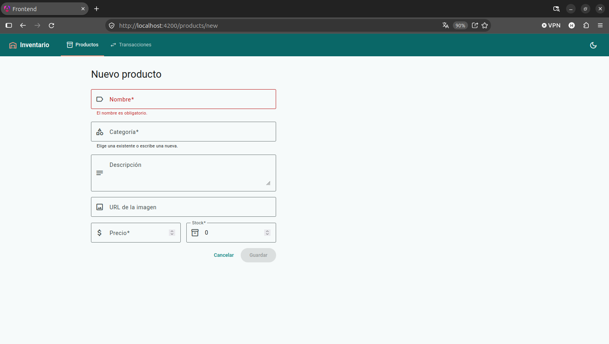
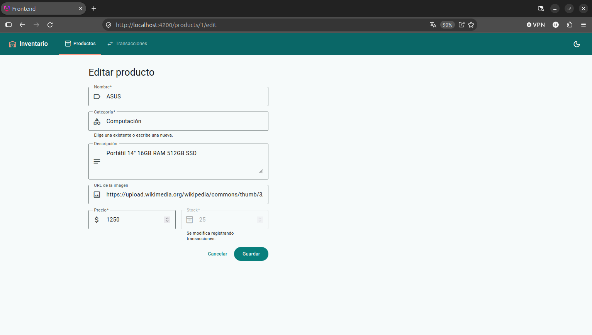
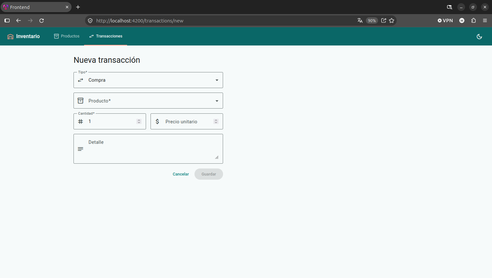
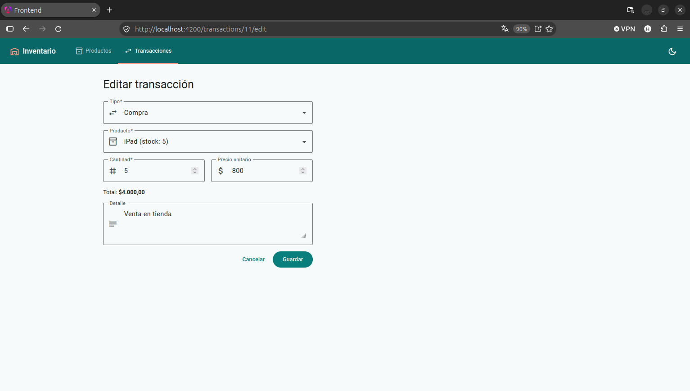
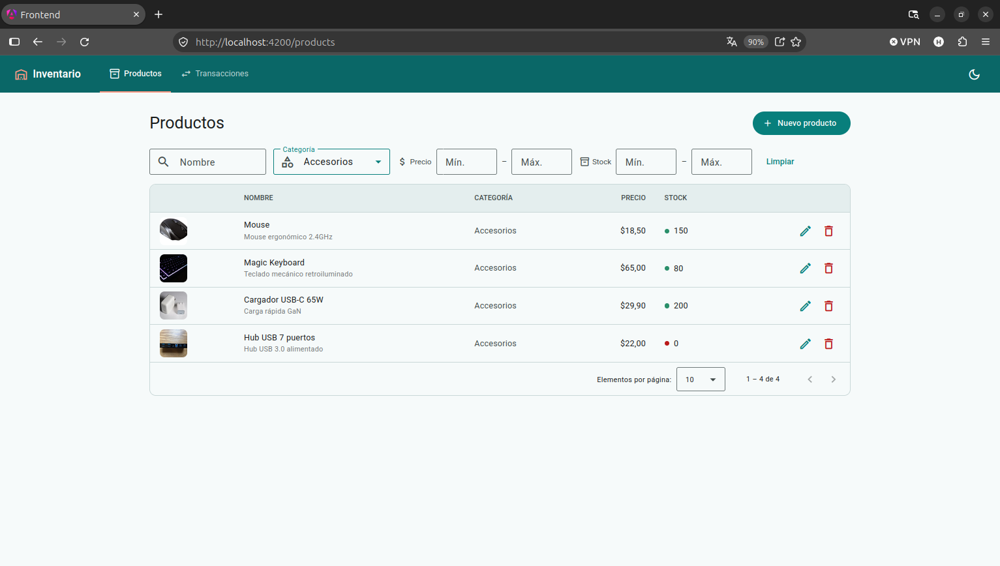

# Gestión de Inventarios

Aplicación web para gestionar **productos** y **transacciones de inventario** (compras y ventas), construida con una arquitectura de microservicios.

- **Backend:** dos microservicios en .NET 10 (ASP.NET Core Web API) que se comunican de forma síncrona por REST.
- **Frontend:** Angular 21 con Angular Material.
- **Base de datos:** PostgreSQL.

## Arquitectura

```
                    ┌────────────────────┐
                    │  Frontend Angular  │  http://localhost:4200
                    └─────────┬──────────┘
              ┌───────────────┴────────────────┐
              ▼                                ▼
   ┌────────────────────┐   REST (síncrono)  ┌────────────────────┐
   │   ProductService   │◄───────────────────│ TransactionService │
   │  :5079  /api/products                   │  :5103  /api/transactions
   └─────────┬──────────┘                    └─────────┬──────────┘
             │ tabla Products                          │ tabla Transactions
             └────────────────┬────────────────────────┘
                              ▼
                  PostgreSQL · base "inventario"
          Transactions.ProductId  →  FK  →  Products.Id
```

- **ProductService** gestiona el catálogo (CRUD, filtros, paginación) y ajusta el stock de forma atómica.
- **TransactionService** registra compras y ventas. Antes de guardar una venta valida el stock llamando a ProductService, y después ajusta el stock. Si el guardado falla tras ajustar el stock, revierte el ajuste.
- Cada servicio solo accede a su propia tabla; entre ellos se comunican únicamente por API REST.

## Requisitos

| Herramienta | Versión |
|---|---|
| [.NET SDK](https://dotnet.microsoft.com/download) | 10.0 |
| [Node.js](https://nodejs.org/) | 20.19+, 22.12+ o 24+ (incluye npm) |
| [PostgreSQL](https://www.postgresql.org/download/) | 12 o superior (probado con 17) |

Opcional: Docker, si prefieres levantar PostgreSQL en un contenedor.

## Base de datos

El script [`script.sql`](script.sql) crea las tablas `Products` y `Transactions`, la clave foránea entre ellas y datos de ejemplo. Se puede ejecutar varias veces sin duplicar datos.

La base de datos debe existir antes de ejecutarlo.

**Con PostgreSQL instalado:**

```bash
createdb -U postgres inventario
psql -U postgres -d inventario -f script.sql
```

**Con Docker:**

```bash
docker run --name inventario-db -e POSTGRES_PASSWORD=TU_CLAVE -p 5432:5432 -d postgres:17
docker exec inventario-db psql -U postgres -c 'CREATE DATABASE inventario'
docker exec -i inventario-db psql -U postgres -d inventario < script.sql
```

## Ejecución del backend

### 1. Configurar la conexión a la base de datos

Los `appsettings.json` traen una clave de ejemplo (`TU_CLAVE`). Para no guardar contraseñas en el repositorio, configura la cadena de conexión con *user secrets* (una vez por servicio):

```bash
dotnet user-secrets set "ConnectionStrings:inventario" "Host=localhost;Port=5432;Database=inventario;Username=postgres;Password=TU_CLAVE" --project src/ProductService
dotnet user-secrets set "ConnectionStrings:inventario" "Host=localhost;Port=5432;Database=inventario;Username=postgres;Password=TU_CLAVE" --project src/TransactionService
```

Cambia `TU_CLAVE` por la contraseña de tu PostgreSQL.

### 2. Levantar los servicios

Cada uno en su propia terminal, desde la raíz del repositorio. **ProductService primero**, porque TransactionService depende de él:

```bash
dotnet run --project src/ProductService       # http://localhost:5079
dotnet run --project src/TransactionService   # http://localhost:5103
```

Documentación interactiva de las APIs (Swagger):

- ProductService: http://localhost:5079/swagger
- TransactionService: http://localhost:5103/swagger

## Ejecución del frontend

```bash
cd src/frontend
npm install
npm start
```

Abre http://localhost:4200. Los backends deben estar en ejecución.

Las URLs de las APIs que usa el frontend están en [`src/frontend/src/app/core/api-urls.ts`](src/frontend/src/app/core/api-urls.ts) (puertos 5079 y 5103).

## Funcionalidades

- **Productos:** crear, editar, eliminar y listar, con imagen, categoría, precio y stock.
  - Tabla con paginación y filtros dinámicos por nombre, categoría, rango de precio y rango de stock.
  - La categoría se elige entre las existentes (con opción de crear una nueva).
- **Transacciones:** registrar compras y ventas, y editarlas o eliminarlas.
  - Tabla con paginación y filtros dinámicos por producto, tipo y rango de fechas.
  - Al filtrar por un producto se muestra su nombre y su stock actual (historial por producto).
- **Validaciones** en los formularios, con mensajes bajo cada campo. Una venta no puede superar el stock disponible.
- **Mensajes de éxito o error** en cada operación.

## Reglas de negocio

- Una **compra suma** stock y una **venta resta** stock, siempre de forma automática.
- No se puede vender más de lo que hay: si el stock es insuficiente, la transacción se rechaza con un mensaje claro.
- Al **editar o eliminar** una transacción, el stock se corrige. Si revertirla dejaría el stock en negativo, se rechaza.
- El **stock inicial** se define al crear el producto. Al editarlo, el stock no se modifica: cambia únicamente mediante transacciones.
- **No se puede eliminar un producto que tenga transacciones**: la clave foránea `Transactions.ProductId → Products.Id` (`ON DELETE RESTRICT`) lo impide y la API responde con un error 409.

## Endpoints

### ProductService (`/api/products`)

| Método | Ruta | Descripción |
|---|---|---|
| GET | `/api/products` | Lista con paginación. Filtros: `name`, `category`, `minPrice`, `maxPrice`, `minStock`, `maxStock`, `page`, `pageSize` |
| GET | `/api/products/{id}` | Obtiene un producto |
| GET | `/api/products/by-ids?ids=1&ids=2` | Obtiene varios productos |
| GET | `/api/products/categories` | Lista las categorías existentes |
| POST | `/api/products` | Crea un producto |
| PUT | `/api/products/{id}` | Actualiza un producto (no modifica el stock) |
| DELETE | `/api/products/{id}` | Elimina un producto (409 si tiene transacciones) |
| POST | `/api/products/{id}/stock-adjustments` | Ajuste atómico de stock (lo usa TransactionService) |

### TransactionService (`/api/transactions`)

| Método | Ruta | Descripción |
|---|---|---|
| GET | `/api/transactions` | Historial con paginación. Filtros: `productId`, `type` (`Purchase` o `Sale`), `from`, `to`, `page`, `pageSize` |
| GET | `/api/transactions/{id}` | Obtiene una transacción |
| POST | `/api/transactions` | Registra una compra o una venta |
| PUT | `/api/transactions/{id}` | Edita una transacción |
| DELETE | `/api/transactions/{id}` | Elimina una transacción y revierte su efecto en el stock |

## Evidencias

### Listado dinámico de productos con paginación



### Listado dinámico de transacciones con paginación



### Creación de productos



### Edición de productos



### Creación de transacciones



### Edición de transacciones



### Filtros dinámicos



### Consulta de información de un formulario (extra)


## Créditos de las imágenes

Las imágenes de los productos de ejemplo son referenciales y se cargan desde [Wikimedia Commons](https://commons.wikimedia.org/). Los autores y las condiciones de cada licencia están en la página de cada archivo.

| Producto | Archivo | Licencia |
|---|---|---|
| Laptop Pro 14 | [Schenker VIA14 Laptop](https://commons.wikimedia.org/wiki/File:Schenker_VIA14_Laptop_asv2021-01.jpg) | Free Art License |
| Mouse Inalámbrico | [A black wireless computer mouse](https://commons.wikimedia.org/wiki/File:A_black_wireless_computer_mouse.jpg) | CC BY-SA 4.0 |
| Teclado Mecánico | [Mechanical Keyboard](https://commons.wikimedia.org/wiki/File:Mechanical_Keyboard.jpg) | CC BY-SA 4.0 |
| Monitor 27" 4K | [Computer monitor samsung](https://commons.wikimedia.org/wiki/File:Computer_monitor_samsung.jpg) | Dominio público |
| Auriculares Bluetooth | [Sony WH-1000XM3](https://commons.wikimedia.org/wiki/File:Sony-WH-1000XM3-kabellose-Bluetooth-Noise-Cancelling-Kopfhoerer.5.jpg) | CC BY 4.0 |
| Parlante Portátil | [JBL Pulse 5 Portable Bluetooth Speaker](https://commons.wikimedia.org/wiki/File:JBL_Pulse_5_Portable_Bluetooth_Speaker.jpg) | CC BY-SA 4.0 |
| Smartphone X12 | [Nexus 4](https://commons.wikimedia.org/wiki/File:Nexus_4-2249.jpg) | CC BY-SA 4.0 |
| Cargador USB-C 65W | [Silicon vs GaN 30W USB-C chargers](https://commons.wikimedia.org/wiki/File:Silicon_vs_GaN_30W_USB-C_chargers.jpg) | CC BY 4.0 |
| Tablet 10" | [Tablet computer](https://commons.wikimedia.org/wiki/File:Tablet_computer.jpg) | CC BY-SA 4.0 |
| Webcam Full HD | [Webcam (Logitech c922)](https://commons.wikimedia.org/wiki/File:Webcam_%28Logitech_c922%29.jpg) | CC0 |
| Disco SSD 1TB | [Dysk SSD Patriot P210 1TB](https://commons.wikimedia.org/wiki/File:2023_Dysk_SSD_Patriot_P210_1TB.jpg) | CC BY-SA 4.0 |
| Hub USB 7 puertos | [USB hub](https://commons.wikimedia.org/wiki/File:USB_hub_1_2019-02-16.jpg) | CC BY-SA 4.0 |

La imagen del iPhone 15 Pro se enlaza desde el sitio de especificaciones técnicas de Apple y es solo referencial.
